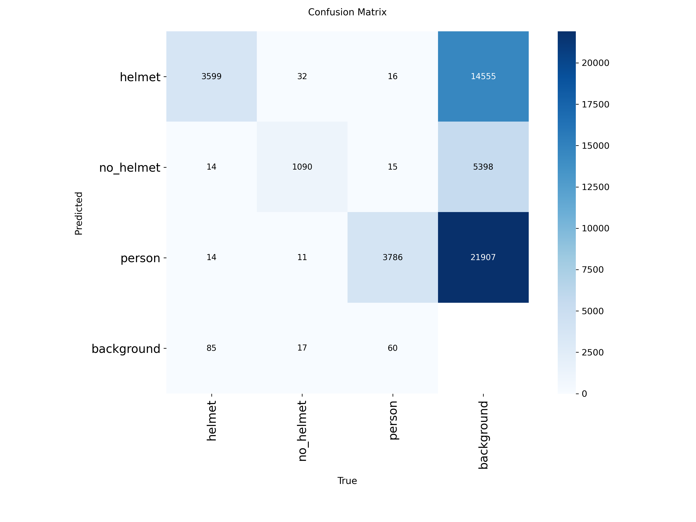
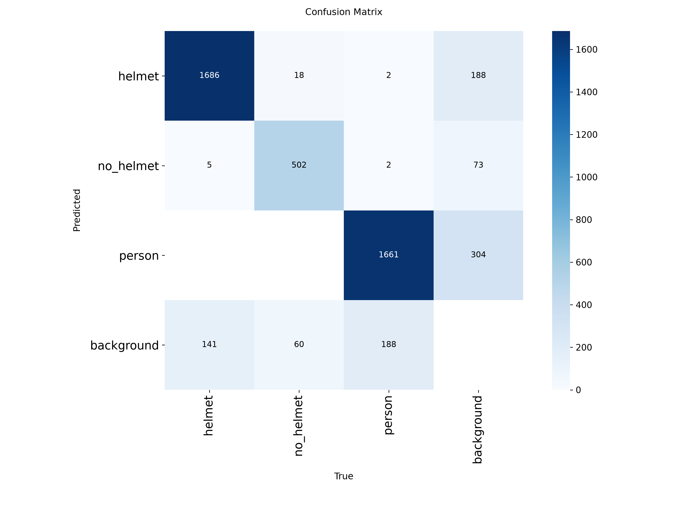
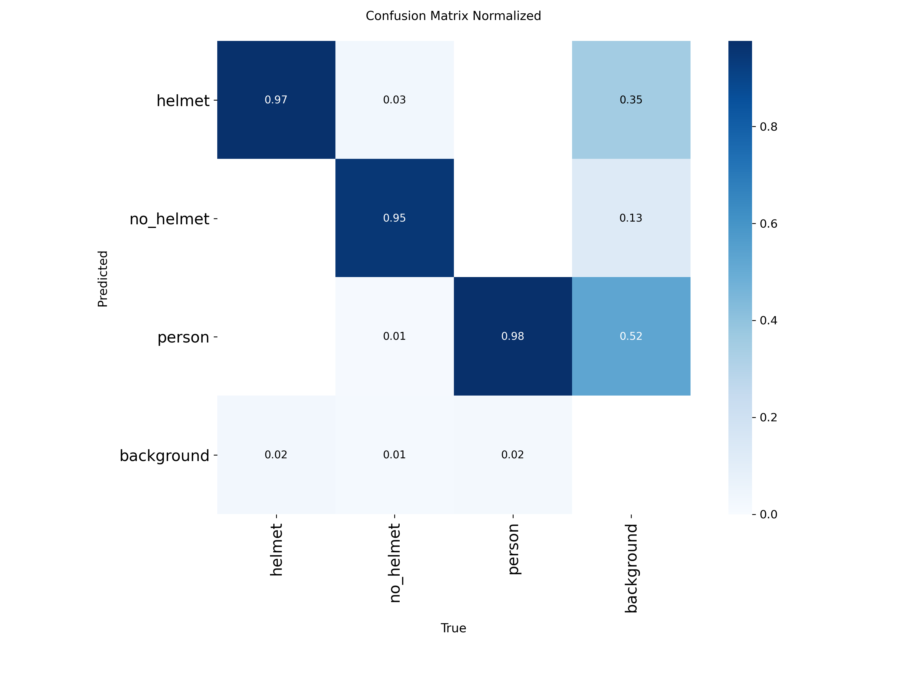

# Safety Helmet Detection using YOLO

A computer vision system that detects whether people are wearing safety helmets, built with Ultralytics YOLO.

**Detected classes**

| ID | Class | Meaning |
|----|-------|---------|
| 0 | `helmet` | A head wearing a safety helmet |
| 1 | `no_helmet` | A bare head (no helmet) |
| 2 | `person` | A whole person, with or without a helmet |

The goal is that every person in an image is detected as `person`, and their head is classified as `helmet` or `no_helmet`.

> **Status:** dataset preparation is complete. Model training and evaluation are in progress.

---

## 1. Dataset

- **Source:** [Hard Hat Detection (Kaggle, by andrewmvd)](https://www.kaggle.com/datasets/andrewmvd/hard-hat-detection)
- **Size:** 5,000 images (mostly about 416 px), all with matching annotation files
- **Original format:** Pascal VOC (XML)
- **Original classes:** `helmet`, `head`, `person`

### Class mapping

| Original label | Project class | ID |
|----------------|---------------|----|
| `helmet` | `helmet` | 0 |
| `head` | `no_helmet` | 1 |
| `person` | `person` | 2 |

### The `person` problem

In the original dataset, `person` is sparsely annotated: only **751** boxes, against **24,751** `helmet` + `head` boxes. Most workers have no `person` box, so training on it as-is would teach the model that unlabeled people are background.

**Solution:** I auto-labeled the missing `person` boxes with a COCO-pretrained YOLOv8m model (COCO class 0 = person). Any detection overlapping an existing `person` box (IoU > 0.5) was skipped to avoid duplicates. The original `helmet` and `no_helmet` labels were not touched.

---

## 2. Data preparation pipeline

```
Kaggle zip (images + VOC XML)
        │
        |   utils/prepare_dataset.py
        ▼  
YOLO labels + 70/20/10 split + data.yaml
        │
        |   utils/add_person_labels.py
        ▼  
Auto-labeled `person` boxes
        │
        |   utils/stats_final_check.py  +  utils/check_boxes.py
        ▼  
Statistics + visual verification
```

### Step 1: VOC to YOLO conversion and split

```
5000 pairs found, 0 XML files without an image
Total boxes per class: {'helmet': 18966, 'no_helmet': 5785, 'person': 751}
```

| Split | Images | helmet | no_helmet | person (original) |
|-------|-------:|-------:|----------:|------------------:|
| train | 3,500 | 13,422 | 4,055 | 475 |
| val | 1,000 | 3,712 | 1,150 | 217 |
| test | 500 | 1,832 | 580 | 59 |
| **Total** | **5,000** | **18,966** | **5,785** | **751** |

Split: 70% / 20% / 10%, random with seed 42.

### Step 2: Auto-labeling `person`

| Split | person before | person after |
|-------|--------------:|-------------:|
| train | 475 | 13,403 |
| val | 217 | 3,877 |
| test | 59 | 1,853 |
| **Total** | **751** | **19,133** |

**18,382 person boxes were added.**

### Final class distribution

| Split | Images | helmet | no_helmet | person |
|-------|-------:|-------:|----------:|-------:|
| train | 3,500 | 13,422 | 4,055 | 13,403 |
| val | 1,000 | 3,712 | 1,150 | 3,877 |
| test | 500 | 1,832 | 580 | 1,853 |
| **Total** | **5,000** | **18,966** | **5,785** | **19,133** |

### Known limitations

- **Class imbalance:** `helmet` is about 3.3x more frequent than `no_helmet`. Per-class precision and recall matter more than overall mAP, especially for `no_helmet`.
- **Auto-generated `person` labels:** they are good but not perfect, and were not fully reviewed by hand. This includes the test split.
- **65 images** have no `person` box at all.
- **2,546 images** contain a helmet/no_helmet box whose center is not inside any `person` box, which usually means the auto-labeler missed a small, blurry, or occluded person. The list is written to `person_review.txt`.
- **Possible near-duplicate images** across splits, which could inflate the metrics slightly.

---

## 3. Project structure

```
Safety-helmet-detection/
├── dataset/                   # generated, not tracked by Git
│   ├── images/{train,val,test}/
│   ├── labels/{train,val,test}/
│   ├── labels/{train,val,test}_backup/   # labels before person auto-labeling
│   └── data.yaml
├── utils/                     # helper scripts (not tracked by Git)
│   └── archive/
│       ├── images/            # downloaded from Kaggle
│       └── annotations/       # VOC XML files
│   └── prepare_dataset.py       # 
│   └── add_person_labels.py       # 
│   └── stats_final_check.py       # 
│   └── check_boxes.py       # 
├── reports/                     # label verification images
│   └── sample_pre_annotation/         # a few images before auto-labeling person
│   └── sample_post_annotation/        # a few images after auto-labeling person
│       ├── person_review.txt          # images needing manual review
└── README.md

```

`dataset/`, `utils/`, weights (`*.pt`), and `runs/` are excluded from Git because of their size.

---

`dataset/data.yaml`:

```yaml
path: <absolute path to dataset>
train: images/train
val: images/val
test: images/test
names:
  0: helmet
  1: no_helmet
  2: person
```

---
## 5. Training on Google Colab

CPU training was too slow (about 10-12 minutes per epoch estimated for YOLOv8n), so the final model was trained on a free Colab **Tesla T4 GPU**.

### Why the dataset isn't in the repo

The images are large and come from Kaggle, so they are not stored on GitHub. Only the prepared YOLO **labels** (including the auto-labeled `person` boxes) are stored, as a small `labels.zip`. In Colab, the images are downloaded from Kaggle and matched to the labels by file name, which rebuilds exactly the same `dataset/` folder.

### Colab workflow

1. **Locally:** zip the labels (`dataset/labels/{train,val,test}`) into `labels.zip` and push it to the repo.
2. **Colab setup:** select Runtime → Change runtime type → T4 GPU. Store a GitHub token in Colab Secrets as `GH_TOKEN` (fine-grained, Contents: read and write, this repo only). Never paste the token into a cell.
3. **Cell 1:** install `ultralytics`, clone the repo using the token.
4. **Cell 2:** upload `kaggle.json`, download `andrewmvd/hard-hat-detection` with the Kaggle CLI, unzip it.
5. **Cell 3:** extract `labels.zip`, copy each image into `dataset/images/{train,val,test}` according to its label file, and write `dataset/data.yaml`. Expected: 3,500 / 1,000 / 500 images.
6. **Cell 4:** train.
7. **Cell 5:** evaluate on the test split.
8. **Cell 6:** zip `runs/` and download it, then copy it into the local project.

### Training configuration

| Setting | Value |
|---------|-------|
| Model | YOLOv8s (COCO-pretrained `yolov8s.pt`), 11.1M parameters, 28.4 GFLOPs |
| Epochs | 50 (completed in about 0.72 hours) |
| Image size | 416 |
| Batch size | 32 |
| Early stopping patience | 15 |
| Seed | 42 |
| Hardware | Colab Tesla T4 |
| Framework | Ultralytics 8.4.215, PyTorch 2.14.1 |

---

---
## 6. Results

The weights used for every number below are `best.pt` (the best epoch on the validation split).

### 6.1 Validation split (1,000 images)

| Class | Images | Instances | Precision | Recall | mAP50 | mAP50-95 |
|-------|-------:|----------:|----------:|-------:|------:|---------:|
| helmet | 899 | 3,712 | 0.955 | 0.899 | 0.957 | 0.628 |
| no_helmet | 196 | 1,150 | 0.929 | 0.884 | 0.936 | 0.618 |
| person | 990 | 3,877 | 0.920 | 0.846 | 0.927 | 0.750 |
| **all** | 1,000 | 8,739 | **0.935** | **0.876** | **0.940** | **0.665** |

Speed on a T4: 0.1 ms preprocess, 2.0 ms inference, 3.2 ms postprocess per image.

### 6.2 Test split (500 images, final score)

| Class | Instances | Precision | Recall | mAP50 | mAP50-95 |
|-------|----------:|----------:|-------:|------:|---------:|
| helmet | 1,832 | 0.939 | 0.891 | 0.945 | 0.630 |
| no_helmet | 580 | 0.915 | 0.849 | 0.908 | 0.601 |
| person | 1,853 | 0.915 | 0.866 | 0.935 | 0.760 |
| **all** | 4,265 | **0.919** | **0.869** | **0.929** | **0.664** |

Speed on a T4: 1.0 ms preprocess, 4.0 ms inference, 2.2 ms postprocess per image.


### 6.3 Training curves


### 6.4 Confusion matrices

The confusion matrix saved in the **training run** folder (`runs/helmet_v8s/`) is computed on the **validation split**, not on the training images. The test one comes from the separate test evaluation.

| Validation split | Test split |
|:---:|:---:|
|  |  |
|  |  |


**Reading the matrices**:

- `helmet` correctly detected: 0.97%
- `no_helmet` correctly detected: 0.95%
- `person` correctly detected: 0.98%
- `helmet` confused with `no_helmet` (and the other way around): 46
- Objects missed (predicted as background): 85 actual helmet, 17 actual no_helmet, 60 actual person
- Background predicted as an object (false positives): 14555 false helmet, 5398 false no_helmt, 21907 false person

> These results are only according to training however i find that in testing confusion matrix its far better with very minimal confusion between helmet & no_helmet along with very few Backgrounds predicted as an object.

### 6.5 Observations

- Validation and test scores are very close (mAP50 0.940 vs 0.929, mAP50-95 0.665 vs 0.664), so the model does not appear to be overfitted to the validation split.
- `no_helmet` reaches 0.936 mAP50 on validation even though it has about 3.3x fewer examples than `helmet`.
- Precision is higher than recall for every class, so the model misses objects more often than it invents them. `person` has the lowest recall (0.846).
- `helmet` and `no_helmet` boxes are small, so their mAP50-95 (about 0.60-0.63) is lower than `person` (0.75), because a few pixels of offset reduces IoU at strict thresholds.
- Most `person` labels were generated by a COCO-pretrained model and not reviewed by hand, so `person` metrics measure agreement with those labels.

### 6.6 Limitations and next steps

- All splits come from one Kaggle dataset, so performance on other sites, cameras, and lighting is untested.
- Near-duplicate images across splits could make the scores slightly optimistic.
- Planned: evaluation on frames from external videos, manual review of the test labels, and more `no_helmet` examples in hard scenes.

---

## 7. Testing on your own videos (optional)

Everything below lives in `utils/` (ignored by Git), so videos and outputs are never committed.

1. **Download a clip** (use videos you are allowed to use, for example Creative Commons):
   ```bash
   pip install yt-dlp
   yt-dlp -f "bv*[height<=720][ext=mp4]" -o "utils/videos/site1.%(ext)s" "<VIDEO_URL>"
   ```
2. **Extract frames** (one frame per second, skipping blurry and near-duplicate frames) with `utils/extract_frames.py`:
   ```bash
   python utils/extract_frames.py
   ```
3. **Run the model** on the frames or on the video with `utils/predict_video.py`. Annotated results are saved in `utils/outputs/`.

---

## 8. Demo app (Streamlit)

A small web app runs the trained model on images, videos, or a webcam.

**Features**

- Image upload, video upload, and live camera modes
- Adjustable confidence threshold
- Live counts of `helmet`, `no_helmet`, and `person`
- A red warning when at least one head without a helmet is detected

**Setup**

1. Put the trained weights at `model/best.pt` (copy `best.pt` from `runs/helmet_v8s/weights/`).
2. Install and launch from the project root:
3. Open the local URL Streamlit prints (usually http://localhost:8501).

---

## 9. Final project structure

```
Safety-helmet-detection/
├── app/
│   └── app.py                 # Streamlit demo
├── dataset/                   # generated locally, not tracked by Git
├── model/
│   └── best.pt                # trained weights (~22 MB)
├── runs/
│   ├── helmet_v8s/            # training run: weights, curves, validation confusion matrix
│   └── test_eval/             # test-split evaluation and confusion matrix
├── labels.zip                 # prepared YOLO labels used in Colab
├── utils/                     # helper scripts, videos, frames (not tracked by Git)
└── README.md
```


## Credits

- Dataset: [Hard Hat Detection](https://www.kaggle.com/datasets/andrewmvd/hard-hat-detection) by andrewmvd on Kaggle (check the dataset page for its license terms).
- Models and training framework: [Ultralytics YOLO](https://github.com/ultralytics/ultralytics).
- YouTube Videos: site1- (https://youtu.be/oJ834e9wDQ4?si=zIZVKfTLBMHJJjP0) / site2- (https://youtu.be/i-NBNlNcJXM?si=3t-fbW7-aYgnFybQ)

Author: Youssef Ahmed